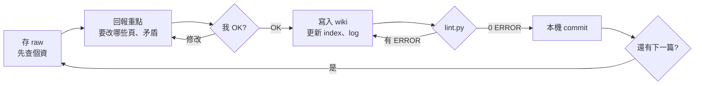
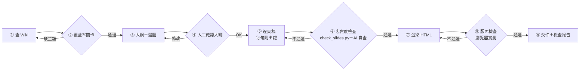

# 繳交標題

空大　〔學號〕　管資　鍾雅婷　赫滋與羊 HerzBaa 品牌 LLM Wiki＋合作夥伴教學簡報

（這份草稿會跟著 repo 公開，學號只填在繳交表單上，不寫進這裡）

---

## 一、Wiki 主題與介紹

**主題：赫滋與羊 HerzBaa 品牌 IP。** 這是我自己經營的插畫品牌，主角是赫滋寶寶和她帶著旅行的羊。

**這份 Wiki 給誰用：**
- 主要讀者是 AI。之後「赫滋小編」（第八週的 IG 貼文 agent）和官網聊天機器人都要讀同一份資料。
- 第一個產出給人看的成品，是給**新合作夥伴／店家**的品牌介紹簡報。

**怎麼建的（先討論、後生成）：**
1. 先做 10 題需求訪談，問題包含主題、讀者、raw 來源、頁面類型、矛盾怎麼處理、ingest 方式、lint 項目、簡報風格、流程、特殊規則。我確認需求摘要後才開始建檔（`docs/需求訪談紀錄.md`）。
2. 照 Karpathy 的 LLM Wiki 架構：`raw/`（原始來源，只增不改）＋ `wiki/`（AI 維護）＋ `AGENTS.md`（唯一的規則檔）。三種操作是 ingest、query、lint，另外有 `index.md` 和 `log.md`。
3. **ingest 了 6 篇公開來源**：官網介紹頁、官網〈故事模特創作計畫〉文章、官網展覽頁、IG〈地方文創第五站 新營〉、IG〈睏睏常設展〉、〈地方文創周邊〉海報。另外把〈睏睏〉展覽海報轉錄成來源，用來拍板展覽類型與展期。
4. 目前的規模：15 個實體頁、7 個來源頁、合作問答 6 題、品牌時間線 16 筆，每一步都有本機 git commit 可以追溯。

**和 Karpathy 原版不同的地方：**

| Karpathy 原版 | 我的調整 | 為什麼 |
|---|---|---|
| 個人研究筆記，內容私有 | 只收公開資訊，lint 會掃 Email、電話、金額、敏感詞 | repo 要公開，而品牌資料夾裡混有合約和個資 |
| LLM 可以自由綜合整理 | 作品寓意只能引用原文並標【原文】，AI 不准詮釋 | 作品的意義是創作者的事，AI 美化或猜測會傷害品牌 |
| 矛盾時由 LLM 標註 | 兩說並列＋【待確認】，對外成品禁用，由我拍板 | 品牌的說法要由創作者本人決定 |
| 一份 wiki 服務一個人 | 每頁都有 summary＋keywords | 多個 agent 要共用 |

## 二、連結

- Wiki（GitHub repo）：https://github.com/Donna12301230/herzbaa-wiki
- 簡報（GitHub Pages）：https://donna12301230.github.io/herzbaa-wiki/slides/brand-intro.html
- 建議從 repo 首頁的 README 開始看，裡面有 Wiki 各重點頁的連結（Wiki 內部用 Obsidian 的 `[[連結]]`，在 GitHub 網頁上不能點）；下載後用 Obsidian 打開 `wiki/` 資料夾，可以看到頁面之間的連結圖。
- 簡報操作：鍵盤左右鍵或畫面下方的按鈕翻頁；手機請橫放。

## 三、Loop／Graph 設計

這份作業有兩個流程，我刻意用了不同的結構。

### 1. Ingest：一次一篇的 Loop

- **為什麼用 loop**：每一篇來源的處理步驟都一樣，差別只在內容。一篇處理完，下一篇再跑一次同樣的步驟。
- **一次一篇、每篇都停下來等我確認**：資料是我的品牌，AI 讀完來源後只能先回報，要等我拍板矛盾和個資，才可以寫入。

### 2. 簡報：有退回路徑的 Graph

- **為什麼用 graph**：簡報有 4 個關卡，每一關失敗時該退回的地方都不同。覆蓋率不夠要回頭查 Wiki；大綱被我打槍要重寫大綱；某一句找不到出處，只要改那一頁的稿；版面爆掉，只要重新渲染。如果用一條直線的 pipeline，任何一關失敗都得整條重跑。
- **人工把關放在「大綱」**：大綱決定了「講什麼、不講什麼」，這一步錯了，後面全部白做。逐字的檢查則交給程式。

完整規則在 `workflows/brand-slides.md`。

## 四、一次實際執行的檢查紀錄（簡報流程，2026-11-16）

| 節點 | 結果 | 抓到什麼 | 怎麼處理 |
|---|---|---|---|
| ② 覆蓋率 | 6/6 ✅ | 程式只抓得到「同一行寫著【待確認】」的句子。Wiki 的寫法是表格照常列出，頁尾再說明爭議，所以美濃常設展、睏睏年份、展覽場數都沒被程式抓到 | 人工對照每頁的待確認段落，列出 10 項排除清單，寫進 `exclude_terms.txt` 讓程式擋 |
| ④ 人工確認 | 我 OK | — | 另外提供舊提案簡報當版面參考 |
| ⑥ 忠實度（第 1 次） | ❌ 3 錯 | 3 句【原文】截斷時，把原文的逗號改成句號 | 退回 ⑤，改用「……」表示省略 |
| ⑥ 忠實度（AI 自查） | ❌ 2 處 | 「讓更多人看見」是 AI 加的意思；「IG @ckhz.art」的出處頁沒寫是 IG | 退回 ⑤ 改句子、補出處 |
| ⑥ 忠實度（第 2 次） | ✅ | 13 頁 58 句全過；負面測試的 6 種錯誤也全部抓到 | — |
| ⑧ 版面（第 1 次） | ❌ | **睏睏海報上印著還在【待確認】的「常設展」和展期**；作品圖被裁；有一張圖不是品牌畫風；小標 15–17px | 退回 ⑦：裁圖、換圖、調字級 |
| ⑧ 版面（第 2 次） | ✅ | 13 頁都沒有文字出界、沒有壓到頁腳，字級 ≥ 20px，圖片都正常載入 | — |

**交件後的修改也照同一套流程：**簡報第一版交件後，又依我的要求跑了四輪修改：加入實景照片、換成我指定的插畫與海報、店名統一成「刻度咖啡」、加入目錄頁。每一輪都重跑 check_slides.py 和版面檢查。其中兩張海報印著 Wiki 還是【待確認】或【待補】的資訊，所以先轉錄成 raw、照 ingest 流程寫進 Wiki 之後，才放進簡報。目前的版本是 14 頁、68 句，全部通過。

完整內容見 `slides/檢查報告.md`。ingest 和 query 測試的紀錄分別在 `docs/執行紀錄.md`（25 筆）和 `docs/query測試紀錄.md`。用第七週的驗收題組挑 12 題測試 query 的結果是：通過 6、部分 4、答不出 2，陷阱和界線題 3/3，**沒有一次編造**。

## 五、反思

### 哪個節點最常出錯？

**「寫入」類的節點最常出錯，而且出的幾乎都是「內容對、形式走樣」的錯。**
- ingest 第 1 篇：AI 寫檔時把 `\n` 原樣寫進 frontmatter，7 個頁面格式壞掉，lint 報了 14 個 ERROR。
- 改 lint 程式時：同樣因為換行跳脫，把檢查程式本身改壞了，而且壞掉的版本還被 commit。
- 簡報逐頁稿：截斷原文時順手改了標點。
- HTML 渲染：排版把「標籤：內文」拆開，導致比對失敗。

第二常出錯的是 **AI 自己加意思**：ingest 第 4 篇寫了「店家負責產品本身」，簡報稿寫了「讓更多人看見」，兩句來源都沒有。這種錯 lint 抓不到，只能靠逐句回頭對照來源。

### 檢查往前移到哪一步？

| 原本在哪裡抓到 | 往前移到哪裡 | 做法 |
|---|---|---|
| ingest 第 2 篇，「分潤 10%」靠人工確認才擋下 | 寫入後的 lint | 把「分潤／抽成＋%」加進 lint 的金額檢查 |
| 改 lint 程式後才發現它壞了 | commit 之前 | 改檢查程式後要跑負面測試，看結束碼才 commit |
| raw 存好之後才發現內容可能抄錯 | 存 raw 的當下 | 存完立刻重新抓一次來源逐字比對（raw 不能改，所以要當下驗） |
| ⑧ 版面檢查時才發現海報上有【待確認】的字 | ③ 大綱選圖 | 流程加規則：「選圖時就要看圖上的字」 |
| ② 覆蓋率要人工翻頁尾的待確認段落 | ⑥ 程式自動擋 | 排除清單寫成 `exclude_terms.txt`，check_slides.py 每次都會檢查 |

### 有沒有因此改 workflow？

有，改了 5 處：
1. **AGENTS.md 規則 1** 改了兩次：「已公開的故事模特姓名可以寫」「合作店家自己公開的營業地址可以寫」。兩次都是 ingest 時遇到實際案例，由我拍板後回頭更新手冊。
2. **workflows/brand-slides.md** 補上 3 條：選圖要看圖上的字、原文截斷用「……」、量字級要量文字而不是容器。
3. **新增 tools/check_slides.py**：原本流程寫的是「之後建立」，第一次執行時就發現人工逐句比對太容易漏，所以直接寫成程式。也加上渲染後的比對，確認稿子每一句都原樣出現在 HTML 裡。
4. **圖片也是來源**：做簡報配圖時，海報上印著 Wiki 還是【待確認】或【待補】的資訊。我們沒有直接把圖放上去，而是先把海報轉錄成 raw、照 ingest 流程寫進 Wiki，再放進簡報。
5. **query 測試的結果也回頭改了 Wiki**：店家地址、睏睏的由來原本為了隱私刻意不寫，測試發現這會讓合作夥伴問不到答案，所以由我決定放寬。

### 最大的收穫

**程式和人抓的是不同的錯。** 程式擅長逐字比對：出處存不存在、原文的標點、金額、錯字。人（或讓 AI 自己回頭查）擅長看「Wiki 沒這樣說」的推論，以及圖片內容。把兩者分別放在對的節點，比全部交給 AI 一次生成可靠得多。
