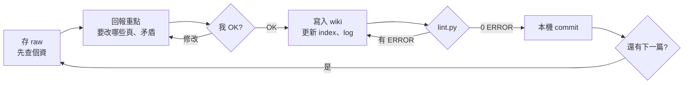
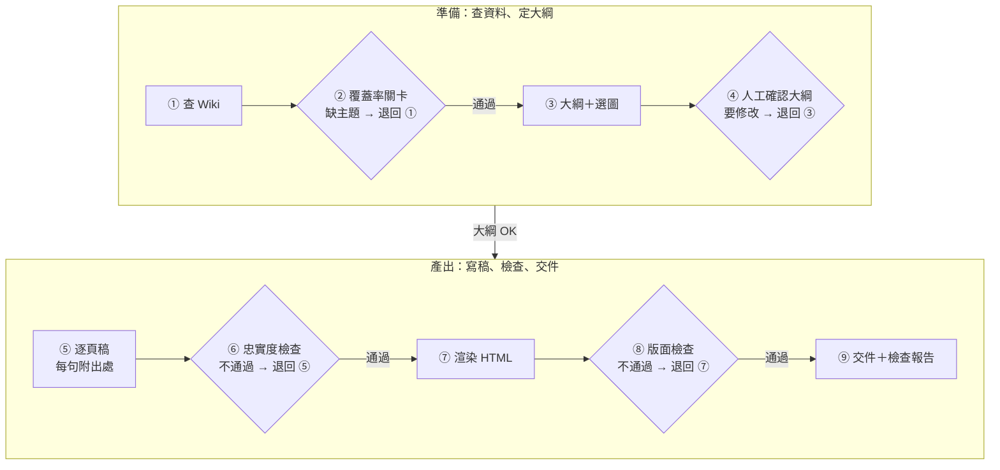

# 繳交標題

空大　〔學號〕　管資　鍾雅婷　赫滋與羊 HerzBaa 品牌 LLM Wiki＋合作夥伴教學簡報

（這份草稿會跟著 repo 公開，學號只填在繳交表單上，不寫進這裡）

---

## 一、Wiki 主題與介紹

**主題：我自己經營的插畫品牌「赫滋與羊」。** 把散在官網、IG、海報的公開資料整理成給 AI 讀的知識庫，之後讓 IG 小編 agent、官網機器人共用；第一個成品是給新合作店家的教學簡報。

- **先討論、後生成**：先做 10 題需求訪談，確認需求摘要後才建檔（`docs/需求訪談紀錄.md`）。
- **架構**：照 Karpathy 的 LLM Wiki，`raw/`（原始來源，只增不改）＋`wiki/`（AI 維護、每句附出處）＋`AGENTS.md`（規則）。操作分成 ingest、query、lint 三種。
- **規模**：ingest 6 篇公開來源（官網 3、IG 2、海報 1），加上 1 份睏睏海報轉錄；共 15 個實體頁、合作問答 6 題、時間線 16 筆。
- **和原版不同的地方**：repo 會公開，所以只收公開資訊，lint 會掃個資與金額；作品寓意只能引用創作者原文，不讓 AI 詮釋；來源矛盾時兩說並列、標【待確認】，由我拍板，對外成品一律不能用待確認的內容。

## 二、連結

- Wiki：https://github.com/Donna12301230/herzbaa-wiki （從 README 開始看，裡面有各重點頁的連結）
- 簡報：https://donna12301230.github.io/herzbaa-wiki/slides/brand-intro.html （左右鍵翻頁，手機請橫放）

## 三、Loop／Graph 設計

### Ingest：一次一篇的 Loop

每篇來源的步驟都一樣，所以用 loop 重複執行。AI 讀完來源只能先回報，等我拍板矛盾和個資之後才寫入。實際的一次回報原文見 `docs/ingest回報範例.md`。

### 簡報：有退回路徑的 Graph

4 個關卡失敗時，各自只退回前一個節點，不用整條重跑。人工把關放在「大綱」，因為大綱決定講什麼、不講什麼；逐字的檢查交給程式（`tools/check_slides.py`）。完整規則見 `workflows/brand-slides.md`。

## 四、一次實際執行的檢查紀錄（簡報第一版，2026-11-16）

| 節點 | 結果 | 抓到什麼 | 怎麼處理 |
|---|---|---|---|
| ② 覆蓋率 | ✅ 6/6 | 程式只抓得到同一行的【待確認】，表格裡的爭議項目會漏掉 | 人工列出 10 項排除清單，寫進程式 |
| ⑥ 忠實度 | ❌→✅ | 3 句原文截斷時改了標點；2 句是 AI 自己加的意思 | 退回 ⑤ 修改後通過 |
| ⑧ 版面 | ❌→✅ | 睏睏海報上印著還在【待確認】的展期；圖被裁；字太小 | 退回 ⑦：裁圖、換圖、調字級 |

之後又依我的要求改了五輪（換照片與海報、統一店名、加目錄、學習目標與重點回顧），每輪都重跑兩種檢查。目前是 14 頁、73 句，全部通過。詳見 `slides/檢查報告.md` 和 `docs/執行紀錄.md`。

**Query 前後對照**：用第七週驗收題組的 12 題只問 Wiki。第一次是通過 6／部分 4／答不出 2；修正之後重測，變成通過 7／部分 3／答不出 2。兩次都沒有編造，陷阱和界線題都是 3/3（`docs/query測試紀錄.md`）。

## 五、反思

> 以下是依紀錄整理的草稿，交出前請改成自己的話。

**最常出錯的節點是「寫入」。** 內容是對的，但形式走樣：寫檔時換行符號出錯、截斷原文時改了標點、排版拆開了句子。第二常見的是 AI 自己加意思，這種錯程式抓不到，只能逐句回頭對照來源。

**檢查往前移到哪裡：**
- 「分潤 10%」第一次是靠人工擋下來的 → 補進 lint，寫入後自動檢查。
- 海報上的字是到版面檢查才發現的 → 移到「③ 選圖」：選圖時就要看圖上的字。
- raw 存好後就不能改 → 存完當下就重新抓一次來源，逐字比對。

**改了哪些 workflow：**
- 新增 check_slides.py。
- 加了「圖片也是來源，要先 ingest 才能放進簡報」的規則。
- AGENTS.md 的公開範圍依實際案例改了兩次。
- query 測試發現合作夥伴問不到地址，所以放寬隱私設定。

**收穫**：程式和人抓的是不同的錯。程式擅長逐字比對，人擅長判斷「來源沒這樣說」的推論和圖片內容。兩者各放在對的節點，比一次交給 AI 生成可靠。
