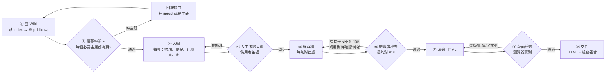

# 簡報流程：給新合作夥伴的品牌介紹（Graph）

> AGENTS.md §6 指到這裡。使用者說「做簡報」「更新簡報」時照這份流程走。
> 讀者：第一次接觸赫滋與羊的店家、品牌、空間主理人。目標：看完知道「赫滋與羊是誰、做過什麼、我可以怎麼合作、怎麼聯絡」。
> 風格：品牌風（奶油底、蜜桃色、咖啡色字、手繪角色圖），10–14 頁，單一 HTML 檔，鍵盤左右鍵翻頁。

## 為什麼用 Graph 而不是一條直線

簡報有三個地方可能要「退回前一步」：
- 覆蓋率不夠 → 退回查 Wiki，或回頭 ingest 新來源
- 大綱被使用者打槍 → 退回改大綱
- 逐頁稿有一句找不到出處 → 退回改那一頁的稿

一條直線的 pipeline 只能整條重跑；Graph 讓每個關卡只退回到該退的節點。

## 流程圖

## 各節點規則

### ① 查 Wiki
- 先讀 `wiki/index.md`，只挑 `public: 可對外` 的頁。
- 把每頁的【待確認】【待補】段落**整段排除**，連帶排除跟它有關的句子（例：赫滋「不穿衣服」）。
- 產出：`slides/_work/01-素材清單.md`（主題 → 可用頁面 → 可用句子數）。

### ② 覆蓋率關卡（自動＋人工）
必要主題，每個至少要有 1 頁可用：

| 主題 | 對應頁面 |
|---|---|
| 品牌是誰 | 赫滋與羊、品牌起源故事、赫滋 |
| 怎麼做 | 聽故事畫故事展故事、故事模特創作計畫 |
| 做過什麼 | 展覽與獲獎、異業合作、地方文創系列、時光抽屜 |
| 店家怎麼合作 | 展覽空間合作、睏睏創作展、刻度咖啡 |
| 能提供什麼 | 服務項目 |
| 怎麼聯絡 | 合作問答 |

- 缺任何一個 → 停下來回報，**不准用常識或印象補**。
- 產出：素材清單最後加一段「覆蓋率：6/6」。

### ③ 大綱
- 每頁寫：頁碼、標題、2–4 個要點、出處頁（`[[頁面]]`）、配圖（素材路徑或「無」）。
- 頁數 10–14；第 1 頁封面、最後一頁聯絡方式。
- **選圖時就要看圖上的字**：海報、宣傳圖常印著日期、展名、價格，要對照排除清單，有就裁掉或換圖（2026-11-16 第一次執行時，睏睏海報上的「常設展」和展期差點進簡報）。
- 產出：`slides/_work/03-大綱.md`。

### ④ 人工確認大綱（必停）
- 把大綱給使用者看，**沒有明確 OK 不往下走**。
- 使用者改的地方記進 `docs/執行紀錄.md`。

### ⑤ 逐頁稿
- 每一句後面標出處 `〔頁面名〕`；HTML 渲染時移到頁腳的小字「資料來源」。
- 引用【原文】時保留引號，不改寫；【官網文案】可以縮短，但不能加意思。
- 不寫金額；合作條件一律「請洽創作者」；官方電話要寫成「品牌官方電話」，不和創辦人姓名同一句。
- 產出：`slides/_work/05-逐頁稿.md`。

### ⑥ 忠實度檢查
- 程式：`python tools/check_slides.py`——檢查每句都有出處、出處頁存在且 public、沒有【待確認】【待補】與排除清單（`slides/_work/exclude_terms.txt`）的詞、【原文】逐字對得上、沒有金額、品牌用字；渲染後再跑一次，確認逐頁稿每一句都原樣出現在 HTML。
- 引用【原文】只截一段時用「……」表示省略，不可改標點。
- 人工（AI 自查）：逐句回頭對 wiki 原句，抓「wiki 沒這樣說」的推論句（ingest 4 就出過這種錯）。
- 有問題 → 退回 ⑤ 只改那一頁。

### ⑦ 渲染 HTML
- 單一檔 `slides/brand-intro.html`，圖片轉成壓縮後的檔案放 `slides/img/`。
- 1280×720 比例、左右鍵與點擊翻頁、頁碼、頁腳資料來源。

### ⑧ 版面檢查
- 內建瀏覽器開啟（launch.json 的 `h10-slides`），每頁檢查：文字沒有超出、圖片有載入、字級 ≥ 20px（頁腳 ≥ 12px）、手機寬度不爆版。
- 量字級要量「文字節點」而不是容器，容器本身的 16px 預設值會誤判。

### ⑨ 交件
- `slides/brand-intro.html` ＋ `slides/檢查報告.md`（每個關卡的結果、退回幾次、為什麼）。
- 在 `wiki/log.md` 記一筆 `query | 合作夥伴簡報`，本機 commit；推上 GitHub 要等使用者說。
